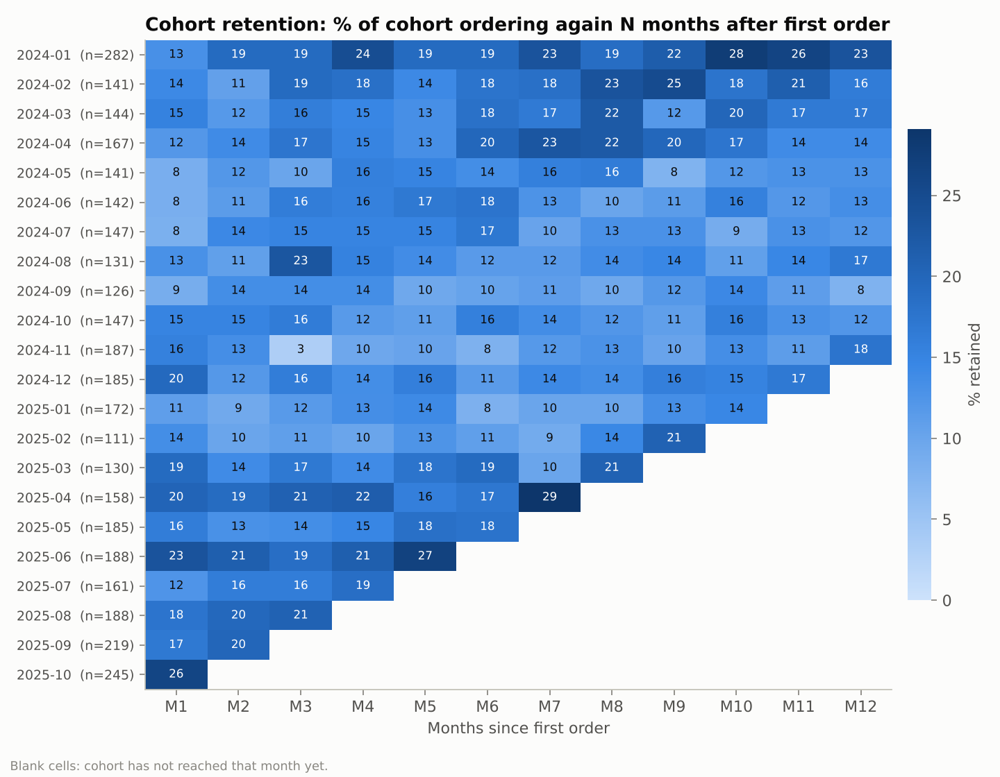
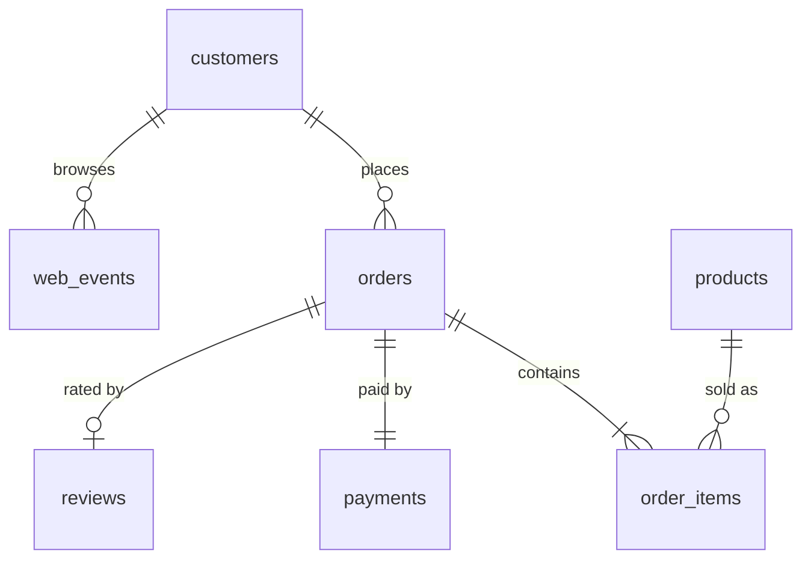

# E-commerce Customer Journey Analytics (SQL)

[](sql/)
[](scripts/)
[](LICENSE)

Customer-journey analytics on a CDP-style e-commerce schema: cohort retention, RFM segmentation,
clickstream funnel, delivery-experience impact and customer lifetime value — written in advanced,
portable SQL and documented the way I would hand it to a business stakeholder.

This project recreates the kind of analysis I did as a Data Analyst on a Customer Data Platform for
an omnichannel retail-tech company. The data is **synthetic** (generated by [`data/generate_data.py`](data/generate_data.py),
fully reproducible from a fixed seed); the questions, SQL patterns and reporting style are real.

**→ Read the findings: [docs/insights.md](docs/insights.md)**



## What's inside

| # | Query | Business question | SQL techniques |
|---|---|---|---|
| 01 | [`data_quality_checks`](sql/01_data_quality_checks.sql) | Can the data be trusted? 17 integrity & business-rule checks | `LEFT JOIN … IS NULL`, `NOT EXISTS`, `UNION ALL` check harness |
| 02 | [`monthly_kpi_overview`](sql/02_monthly_kpi_overview.sql) | Revenue, AOV, margin, new vs returning, MoM / YoY growth | `LAG(… , 12)`, running totals, conditional aggregation |
| 03 | [`cohort_retention`](sql/03_cohort_retention.sql) | Do newer cohorts stick better? | self-join on cohort month, month-offset arithmetic, pivot with `CASE` |
| 04 | [`rfm_segmentation`](sql/04_rfm_segmentation.sql) | Who are our champions, who is slipping away? | `NTILE(5)`, rule-based segmentation, value index |
| 05 | [`conversion_funnel`](sql/05_conversion_funnel.sql) | Where does each channel lose shoppers? | session-level flags, step conversion, drop-off detection |
| 06 | [`repeat_purchase_behaviour`](sql/06_repeat_purchase_behaviour.sql) | How fast and how often do customers come back, by acquisition channel? | `ROW_NUMBER`, `LAG`, median via window ranks |
| 07 | [`delivery_experience_and_reviews`](sql/07_delivery_experience_and_reviews.sql) | Does a late first delivery cost us the customer? | date arithmetic, first-event isolation, two-part result set |
| 08 | [`category_performance_pareto`](sql/08_category_performance_pareto.sql) | Which categories make the money — and the margin? | cumulative share, Pareto classification |
| 09 | [`customer_lifetime_value`](sql/09_customer_lifetime_value.sql) | Which acquisition channel is worth paying more for? | tenure-horizon value with observability guard |

Supporting material:

- [`docs/erd.md`](docs/erd.md) — entity-relationship diagram (Mermaid) and table grains
- [`docs/data_dictionary.md`](docs/data_dictionary.md) — every column, every metric definition
- [`outputs/`](outputs/) — the result of every query as CSV, plus charts

## Key findings (short version)

1. **22% of customers generate 58% of revenue**; a further 15% of high-value customers have gone quiet for ~11 months and are the top win-back target.
2. **Referred customers are worth 1.6× paid-social customers** over 12 months and repeat a month sooner — the acquisition mix should shift.
3. **Late delivery costs 1.3 review stars and 5.5 points of repeat rate**; the Central region is late on 22% of orders.
4. The funnel's biggest leak is **product page → cart** on every owned channel; social-commerce traffic leaks at the landing page instead.
5. The largest category by revenue (Phones & Gadgets) runs at **8.6% gross margin** — a traffic driver, not a profit centre.

Full write-up with charts and recommendations: [docs/insights.md](docs/insights.md).

## Schema



7 tables · 4,000 customers · 13.4k orders · 23.6k order lines · 301k clickstream events.
Full diagram and column list in [`docs/erd.md`](docs/erd.md).

## Run it yourself

```bash
git clone https://github.com/Hakian14/ecommerce-customer-journey-sql.git
cd ecommerce-customer-journey-sql
pip install -r requirements.txt          # pandas, matplotlib only

python data/generate_data.py             # (optional) regenerate the CSVs — deterministic
python scripts/build_db.py               # load SQLite + run all 9 queries -> outputs/*.csv
python scripts/make_charts.py            # render charts -> outputs/charts/*.png
```

Or open `data/ecommerce.db` in any SQLite client (DBeaver, DB Browser for SQLite) after `build_db.py`
and run the files in `sql/` interactively.

**Dialect notes.** The SQL targets SQLite 3.25+ (window functions). To run on PostgreSQL, replace
`strftime('%Y-%m', ts)` with `to_char(ts, 'YYYY-MM')`, `julianday(a) - julianday(b)` with `a::date - b::date`,
and `DATE(ts, 'start of month')` with `date_trunc('month', ts)`. No other changes are needed.

## Repository layout

```
├── data/
│   ├── generate_data.py      # synthetic data generator (seeded)
│   └── raw/                  # 7 CSVs (web_events is gzipped)
├── sql/
│   ├── 00_schema.sql         # DDL + indexes
│   └── 01…09_*.sql           # one analysis per file, heavily commented
├── scripts/
│   ├── build_db.py           # CSV -> SQLite -> run queries -> outputs/
│   └── make_charts.py        # outputs/*.csv -> outputs/charts/*.png
├── outputs/                  # query results + charts (committed, so you can read without running)
└── docs/                     # ERD, data dictionary, insights write-up
```

## About

Built by **Ha Kieu Anh** — Data Analyst (5+ years in e-commerce, retail and CRM analytics), now also
working in AI training & evaluation. [GitHub](https://github.com/Hakian14) · [LinkedIn](https://www.linkedin.com/in/kieu-anh-ha-6249a3172/) · hakieuanh662@gmail.com

License: [MIT](LICENSE)
