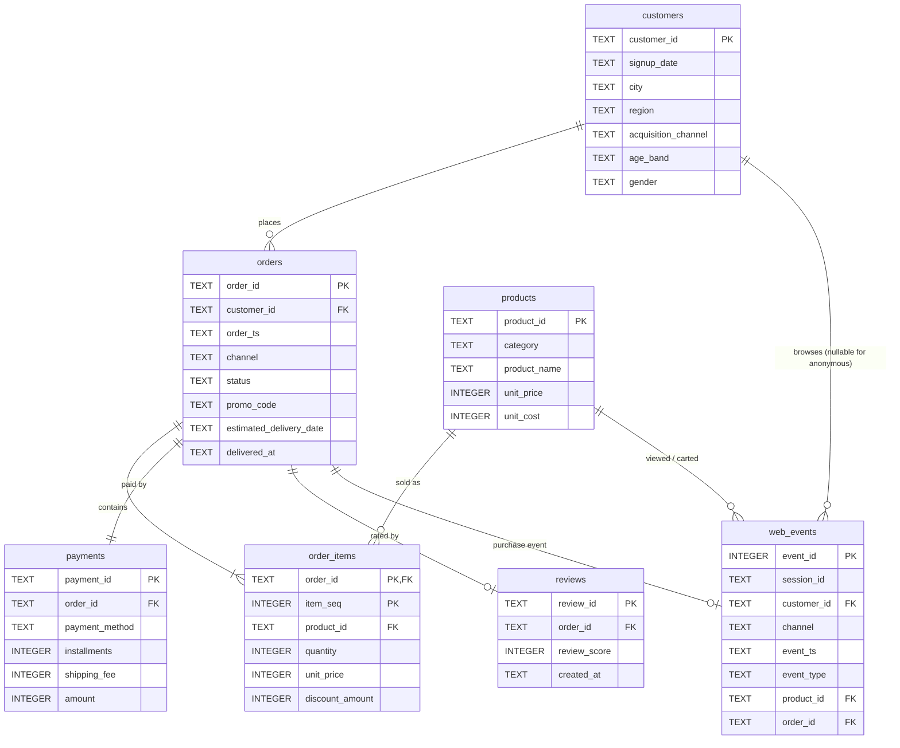

# Entity-relationship diagram

The schema follows the shape of a Customer Data Platform (CDP): one golden
customer record, transactional tables keyed on `order_id`, and a clickstream
table that links anonymous browsing to known customers and to completed orders.

## Grain of each table

| Table | One row per | Notes |
|---|---|---|
| `customers` | registered customer | `acquisition_channel` is how the customer was first acquired; `orders.channel` is where each order was placed. They are different dimensions on purpose. |
| `products` | SKU | `unit_cost` enables gross-margin analysis. |
| `orders` | order header | `status` is the order's final state at snapshot time. Revenue analyses use `delivered` only. |
| `order_items` | order line | `unit_price` is the price at time of sale; `discount_amount` is the total discount on the line. |
| `payments` | order (1:1) | `amount = Σ(line net value) + shipping_fee`, checked in `01_data_quality_checks.sql`. |
| `reviews` | order (0..1) | Only delivered/returned orders can have a review; ~62% do. |
| `web_events` | clickstream event | A session is a sequence of events sharing `session_id`. `customer_id` is NULL for anonymous sessions; `order_id` is populated only on `purchase` events. |
