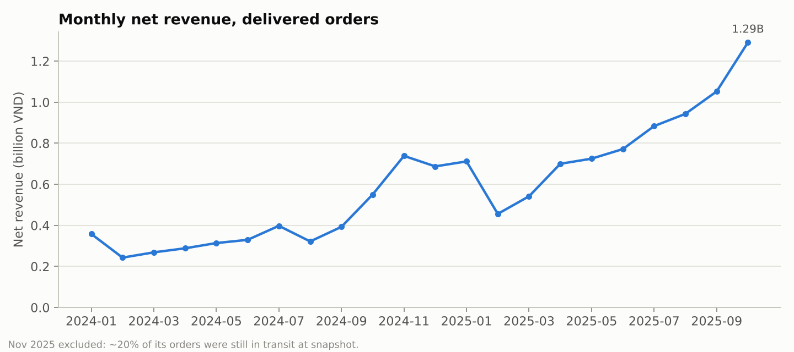
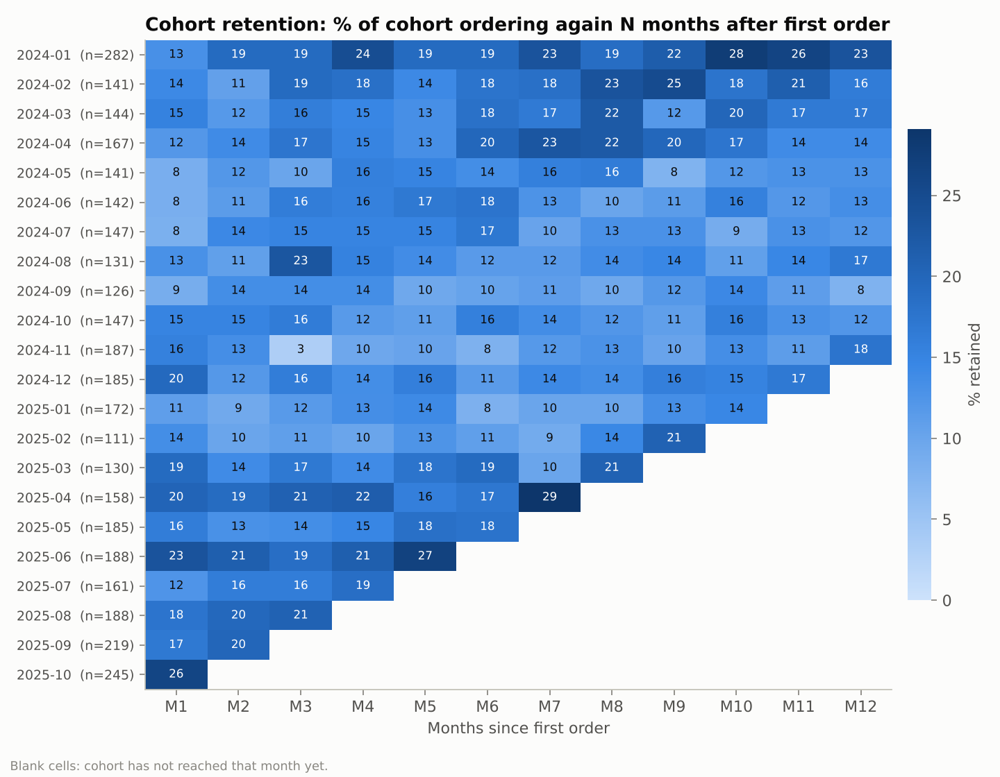
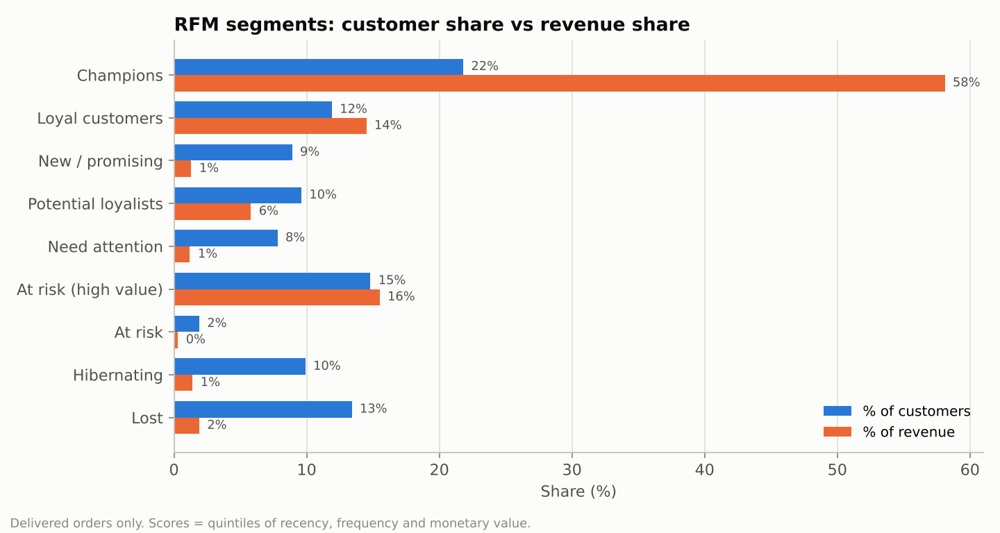
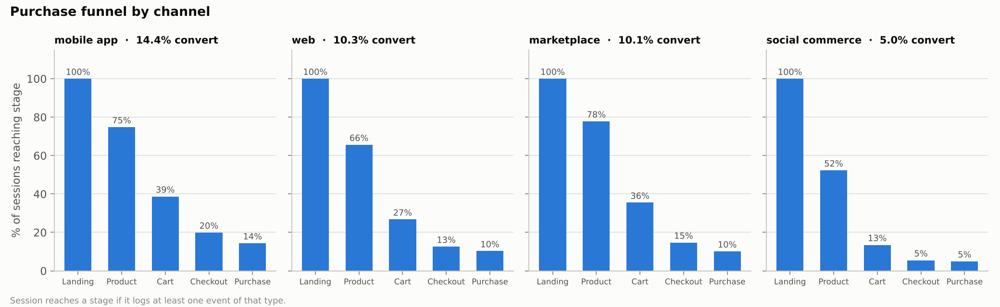
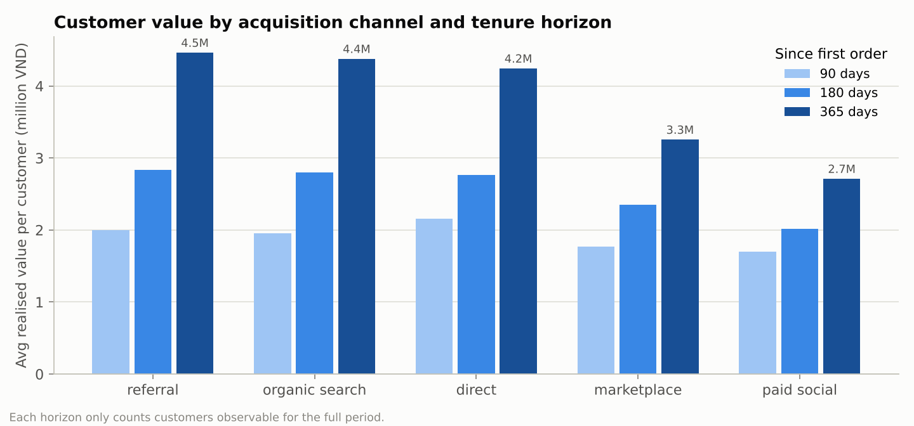

# Findings and recommendations

Snapshot: 1 Jan 2024 – 30 Nov 2025 · 4,000 customers · 13,429 orders · 134k browsing sessions.
Every number below comes from a query in `sql/`; the output CSVs are in `outputs/`.

> The dataset is synthetic, so the "business" is fictional — but the analytical
> questions, the SQL, and the way the findings are framed are exactly what I
> delivered as a Data Analyst on a Customer Data Platform.

---

## 1. The business is growing on the back of returning customers

*Query: `02_monthly_kpi_overview.sql`*

- Net revenue (delivered orders) was **4.89B VND in 2024** and **8.08B VND in Jan–Oct 2025** — on track for roughly 2× year on year.
- The share of monthly active customers who are *returning* climbed from ~21% in Feb 2024 to **~70% through H2 2025**. Growth is no longer purchase-by-acquisition; it is a compounding base.
- Seasonality is sharp: November (11.11) and December (12.12) carry ~2× the revenue of a typical month. Tet (January) is the third peak.

**Watch-out:** November 2025 shows 22.6% of orders not yet delivered. That is a snapshot artefact (orders still in transit), not a quality problem — but it is the reason the KPI query reports `orders_placed` and `orders_delivered` separately.

## 2. Retention plateaus at ~15% — the loyal core is stable, and newer cohorts are stickier

*Query: `03_cohort_retention.sql`*

- Across all cohorts, about **15% of a cohort places an order in any given month after acquisition**, and that rate barely decays from M1 to M12. This is the signature of a two-population base: a loyal core that keeps buying, and a majority who buy once.
- Cohorts acquired in 2025 show **17.7% M1 retention vs 12.6% for 2024 cohorts** — onboarding or product-mix changes made since early 2025 appear to be working.

## 3. 22% of customers generate 58% of revenue — and 15% of customers worth another 16% are slipping away

*Query: `04_rfm_segmentation.sql`*

| Segment | Customers | Revenue | Avg days since last order |
|---|---|---|---|
| Champions | 21.8% | **58.1%** | 25 |
| Loyal customers | 11.9% | 14.5% | 88 |
| **At risk (high value)** | **14.8%** | **15.5%** | **322** |
| Hibernating + Lost | 23.3% | 3.3% | 246–491 |

- The **"At risk (high value)"** segment is the single most actionable group in the dataset: 557 customers who used to buy frequently (2.4 orders on average, 4.1M VND each) and have not ordered in ~11 months. A win-back campaign here is worth far more than reactivating the "Lost" segment, which never spent much to begin with.
- The three low-value dormant segments (Need attention, Hibernating, Lost) are 31% of the base but 4.5% of revenue — reactivation spend should be capped accordingly.

## 4. The funnel leaks between product view and cart — and social commerce leaks at the landing page

*Query: `05_conversion_funnel.sql`*

| Channel | Session conversion | Biggest drop-off |
|---|---|---|
| Mobile app | **14.4%** | product → cart (52% proceed) |
| Web | 10.3% | product → cart (41%) |
| Marketplace | 10.1% | product → cart (46%) |
| Social commerce | **5.0%** | landing → product (only 52% view a product) |

- Blended conversion is 10.0%. The largest leak everywhere except social is **product → cart**: fewer than half of visitors who view a product add it to the cart. Price anchoring, reviews placement, and stock / delivery-time visibility on the product page are the obvious levers.
- **Social commerce** traffic is different: half of its sessions never reach a product page. Landing pages for social campaigns should deep-link to the product, not to the storefront.
- Once a customer starts checkout, 72–91% complete it. Checkout UX is not the problem.

## 5. Where a customer came from predicts whether they come back

*Queries: `06_repeat_purchase_behaviour.sql`, `09_customer_lifetime_value.sql`*

| Acquisition channel | Repeat rate | Median days to 2nd order | 1-year value / customer |
|---|---|---|---|
| Referral | **55.3%** | 57 | **4.46M VND** |
| Organic search | 54.5% | 59 | 4.38M |
| Direct | 49.9% | 76 | 4.25M |
| Marketplace | 45.5% | 64 | 3.26M |
| Paid social | **38.4%** | 87 | **2.71M** |

- A referred customer is worth **1.6× a paid-social customer** over 12 months, and comes back a month sooner.
- Paid-social customers also front-load their value: only 42% of their first-year revenue comes after day 90, versus ~55% for every other channel. They buy the promoted item and leave.
- **Recommendation:** re-weight acquisition budget toward the referral programme and organic content; hold paid social to a CAC ceiling derived from the 2.7M VND one-year value, not from first-order margin.

## 6. Late delivery is a retention problem, not just an ops metric

*Query: `07_delivery_experience_and_reviews.sql`*

- **21.7% of deliveries to the Central region are late**, vs 11.7% in the North and 15.3% in the South.
- A late delivery costs about **1.3 stars**: average review 4.2 when on time, 2.9–3.0 when late.
- Customers whose *first* order arrived late repeat at **43.9% vs 49.4%** — a 5.5-point gap on the single most important moment in the customer journey.
- **Recommendation:** add a Central-region carrier or adjust the promised delivery window there; a late promise kept is cheaper than a broken one.

## 7. Six categories make 76% of revenue; the biggest one barely makes margin

*Query: `08_category_performance_pareto.sql`*

- Six of fifteen categories form the Pareto "A" class (76% of net revenue).
- **Phones & Gadgets** is the largest category by revenue (17%) but runs at **8.6% gross margin**, versus 40–55% for fashion and home. It drives traffic and basket size, not profit — pricing and promo depth there should be managed as a loss-leader, not as a growth category.
- Return rates are uniform (2.4–3.9%); no category stands out as a quality problem.

---

## Priority actions

1. **Win-back campaign** for the *At risk (high value)* RFM segment (557 customers, 15.5% of historical revenue).
2. **Fix Central-region delivery** — target the 21.7% late rate; measure impact on first-order repeat rate.
3. **Product-page conversion** work (product → cart is the biggest leak on every owned channel); deep-link social campaigns to product pages.
4. **Shift acquisition mix** toward referral and organic; cap paid-social CAC against its 2.7M VND one-year value.
5. **Manage Phones & Gadgets as a traffic driver** with explicit margin guardrails.

## Limitations

- Synthetic data: effect sizes were designed to be detectable, so real-world signals will be noisier.
- Attribution is first-touch only (`acquisition_channel`); multi-touch attribution would need the clickstream joined to campaign data.
- Retention is measured on calendar months, which slightly under-counts customers who repeat within the same month as their first order.
